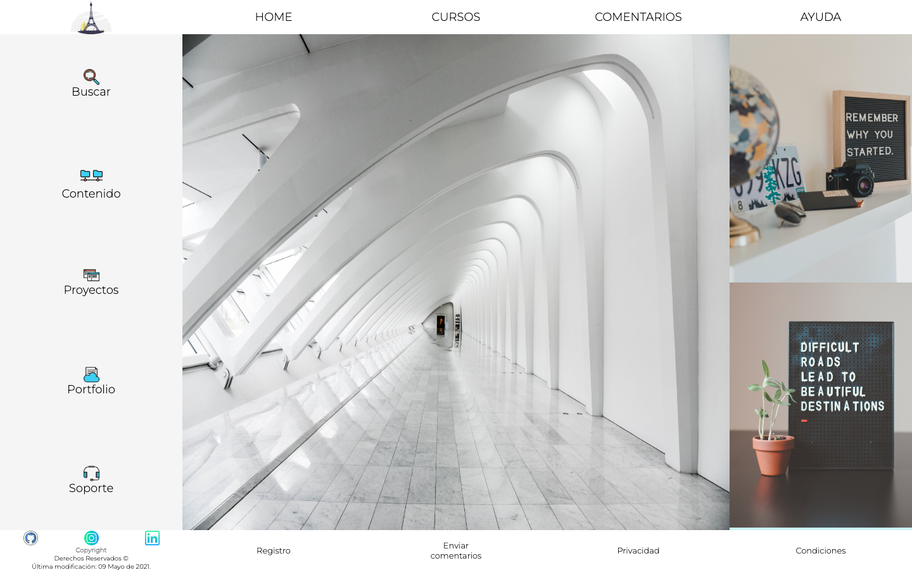
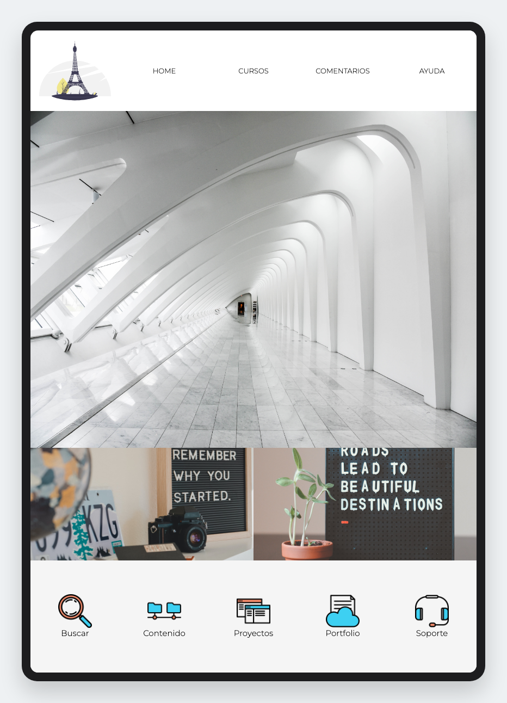
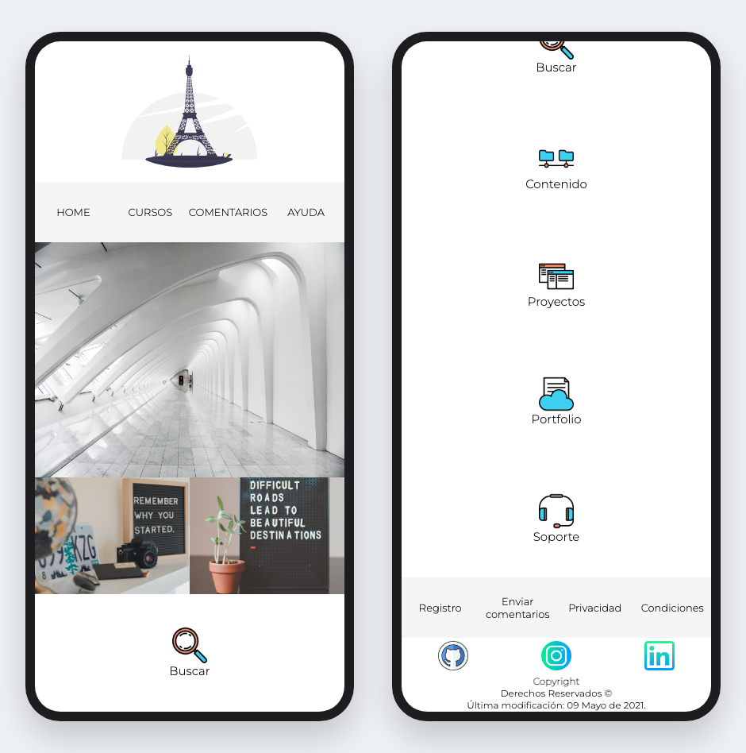

<a id="top"></a>

<h1 align="center">🗼 American Charge</h1>

<p align="center">
  A responsive landing page built with pure semantic HTML and CSS, following a Mobile First strategy and the Layout Shifter pattern.
</p>

<p align="center">
  <a href="https://american.nesst-tech.online/">
    
  </a>
</p>

<p align="center">
  
  
  
  
</p>

<p align="center">
  <a href="https://american.nesst-tech.online/">
    
  </a>
</p>

## Contents

- [Features](#features)
  - [Mobile First with three breakpoints](#mobile-first-with-three-breakpoints)
  - [Layout Shifter](#layout-shifter)
  - [Flexbox-only layout](#flexbox-only-layout)
  - [Interactions](#interactions)
- [Project structure](#project-structure)
- [Getting started](#getting-started)
- [Deployment](#deployment)
- [Branching model](#branching-model)
- [Background](#background)

---

## Features

### Mobile First with three breakpoints

The base stylesheet targets phones, and each larger screen adds its own stylesheet on top. The tablet and desktop sheets are linked with a `media` attribute, so they only apply when the query matches:

```html
<link rel="stylesheet" href="public/styles.css" />
<link rel="stylesheet" href="public/ipad_styles.css" media="screen and (min-width: 720px)" />
<link rel="stylesheet" href="public/desktop_styles.css" media="screen and (min-width: 1200px)" />
```

| Screen | Stylesheet | Layout |
|---|---|---|
| **Mobile** (< 720px) | `styles.css` | One column: logo, menu, hero image, two featured photos, then the shortcuts and the footer |
| **Tablet** (≥ 720px) | `+ ipad_styles.css` | Logo and menu share one bar, and the shortcuts become a single row |
| **Desktop** (≥ 1200px) | `+ desktop_styles.css` | Three columns: shortcuts sidebar, hero image and featured photos. The content is capped at 2000px wide |

### Layout Shifter

The HTML is written once. Each breakpoint rearranges the same blocks with Flexbox `order` and `flex-direction`, without duplicating any markup:

<table>
  <tr>
    <td align="center" width="50%">
      <br>
      <sub><b>Tablet:</b> the shortcuts move from a vertical list to a single row.</sub>
    </td>
    <td align="center" width="50%">
      <br>
      <sub><b>Mobile:</b> the content comes first and the shortcuts stack below it (left: top of the page, right: bottom).</sub>
    </td>
  </tr>
</table>

| Block | Mobile | Desktop |
|---|---|---|
| Shortcuts (`aside`) | After the content (`order: 2`), stacked | Left sidebar (`order: 1`), 20% of the width |
| Featured photos | A row of two under the hero image | A column on the right, 25% of the content |
| Footer | Links on top, social icons and copyright below | Copyright on the left, links on the right |

### Flexbox-only layout

- Every layout is built with **Flexbox**. There is no CSS Grid, framework or JavaScript.
- Sizes use viewport units (`vw` / `vh`) for the main blocks, which is the *Mostly Fluid* approach.
- `html { font-size: 62.5% }` makes `1rem = 10px`, so text sizes are easy to read in the CSS (`1.5rem` = 15px).
- **Semantic HTML5:** `header`, `nav`, `main`, `aside`, `section`, `figure`/`figcaption` and `footer`.

### Interactions

- Menu items and shortcuts light up in green (`rgba(8, 190, 144)`) on hover.
- Shortcuts shrink slightly while they're pressed (`transform: scale(0.95)`), like a button.
- Featured photos fade on hover and open the full-size image on click.
- The **Proyectos** and **Portfolio** shortcuts link to my portfolio at [nesst.tech](https://nesst.tech/).

---

## Project structure

```text
├── index.html
├── netlify.toml               # Netlify deploy settings and cache headers
├── CHANGELOG.md
├── public/
│   ├── styles.css             # Mobile (base styles)
│   ├── ipad_styles.css        # Tablet (≥ 720px)
│   └── desktop_styles.css     # Desktop (≥ 1200px)
├── assets/img/                # Logo, shortcut icons and social icons
└── docs/images/               # README screenshots
```

The large photos are served from the Cloudinary CDN, so the repository only stores the icons.

## Getting started

It's a static site with no build step and no dependencies.

1. Clone the repo

   ```bash
   # HTTPS
   git clone https://github.com/nqs48/AmericanCharge_ADev.git

   # SSH
   git clone git@github.com:nqs48/AmericanCharge_ADev.git
   ```

2. Open `index.html` in the browser, or serve the project root with any static server:

   - **VS Code:** the [Live Server](https://marketplace.visualstudio.com/items?itemName=ritwickdey.LiveServer) extension.
   - **Python:**

     ```bash
     python3 -m http.server 8080
     ```

     Then open [http://localhost:8080](http://localhost:8080).

## Deployment

The site is deployed on **Netlify** at [american.nesst-tech.online](https://american.nesst-tech.online/), with an automatic Let's Encrypt certificate and HTTP redirected to HTTPS.

- Every push to `main` publishes a new version, so production always matches the latest release.
- [`netlify.toml`](netlify.toml) publishes the repository root with no build command and sets cache headers:

| Path | `Cache-Control` |
|---|---|
| `/assets/*` (icons) | `public, max-age=604800` (7 days) |
| `/public/*` (stylesheets) | `public, max-age=86400` (1 day) |

The site was first hosted on Heroku, which needed an `index.php` file to serve static HTML. It moved to Netlify in [v1.0.0](CHANGELOG.md) when Heroku's free tier ended.

## Branching model

This repository follows **Git Flow**:

| Branch | Created from | Merged into | Purpose |
|---|---|---|---|
| `main` | — | — | Production (deployed site) |
| `develop` | `main` | `main` | Integration of finished work |
| `feature/*`, `docs/*` | `develop` | `develop` | New features and documentation |
| `release/x.y.z` | `develop` | `main` and `develop` | Release preparation, tagged `vX.Y.Z` |
| `hotfix/*` | `main` | `main` and `develop` | Urgent production fixes |

Commits follow [Conventional Commits](https://www.conventionalcommits.org/), and each release is documented in the [CHANGELOG](CHANGELOG.md).

---

## Background

This project started in 2021 as the final practice of Platzi's *Curso Definitivo de HTML y CSS*: a responsive page that applies Mobile First, the Layout Shifter pattern and media queries using only HTML and CSS.

## Built with

- [Semantic HTML5](https://developer.mozilla.org/en-US/docs/Web/HTML)
- [CSS3](https://developer.mozilla.org/en-US/docs/Web/CSS) (Flexbox, media queries, BEM-style class names)
- [Montserrat](https://fonts.google.com/specimen/Montserrat) font from Google Fonts
- [Cloudinary](https://cloudinary.com/) for the photos
- [Netlify](https://www.netlify.com/) for hosting
- [Git](https://git-scm.com/)

---

<!-- LICENSE -->
## License

Distributed under the MIT License. See `LICENSE` for more information.

---

<!-- CONTACT -->
## Collaborators

<table>
  <tr>
    <td align="center" width="150">
      <a href="https://github.com/nqs48">
        
      </a>
    </td>
    <td>
      <h3>Nestor Quiroga Suárez</h3>
      <b>Full Stack Software Engineer</b> · AI-Native Engineering<br>
      <sub>.NET · Node.js · Angular · React · AWS · Azure</sub>
      <br><br>
      <a href="https://www.linkedin.com/in/nqs48/"></a>
      <a href="https://nesst.tech"></a>
      <a href="mailto:nqs48@hotmail.com"></a>
      <a href="https://github.com/nqs48"></a>
    </td>
  </tr>
</table>

<p align="center">
  <a href="#top">Back to top ↑</a>
</p>
